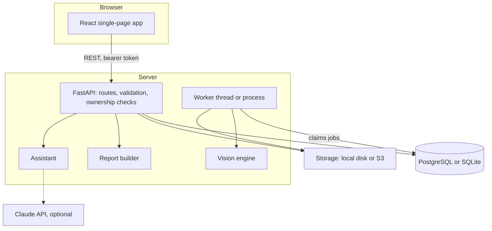
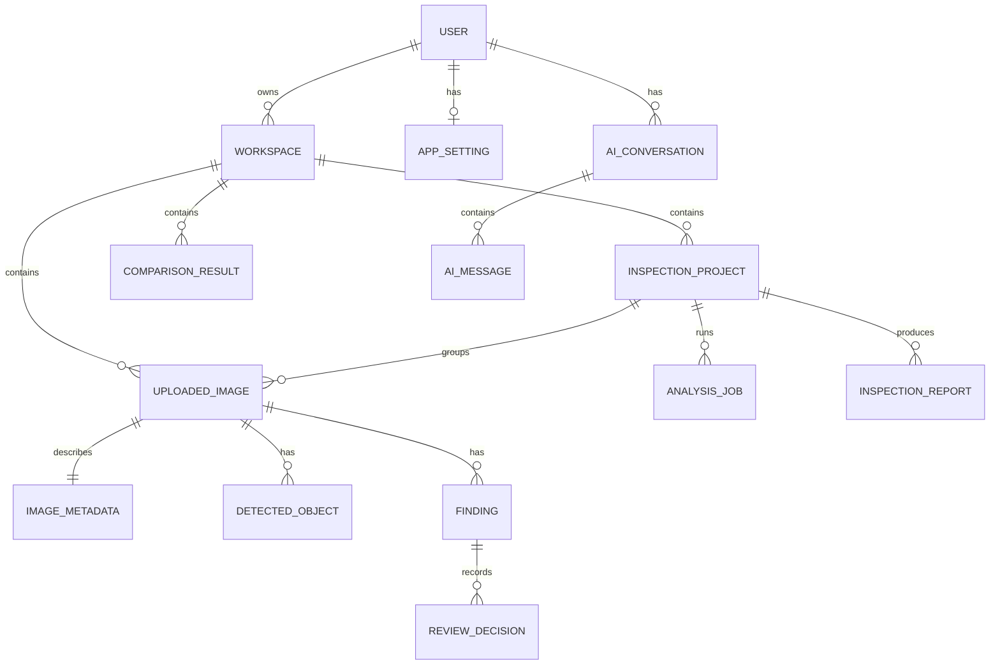
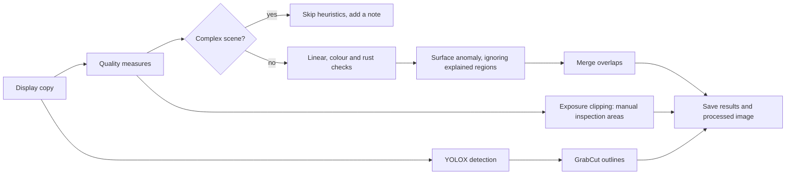
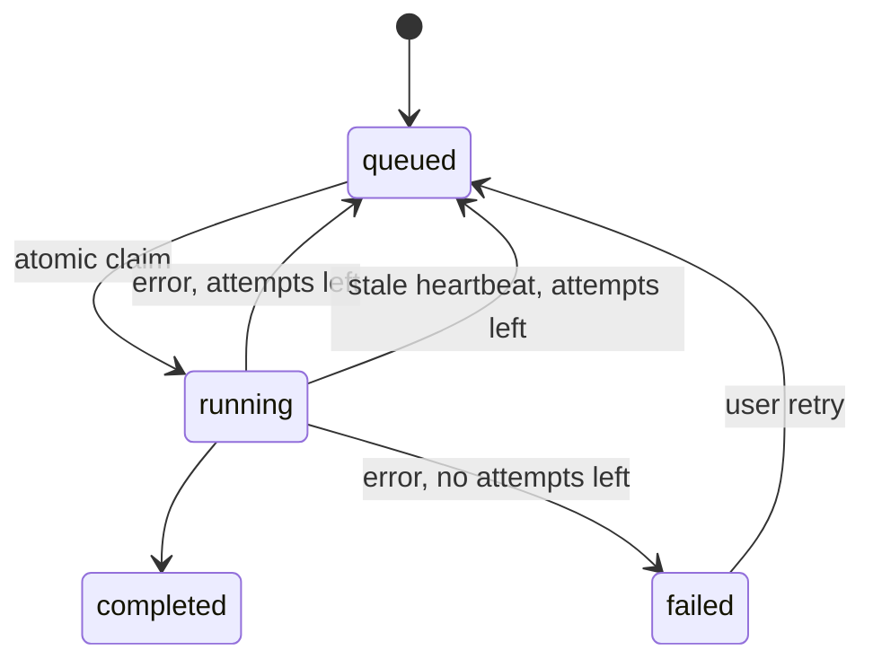

# Architecture

## System overview



## Frontend

`frontend/src` is a Vite, React and TypeScript single-page app with no state library.

| Folder | Responsibility |
|---|---|
| `services/api.ts` | The only module that talks to the API. Adds the token and normalises errors |
| `hooks/` | `useApi` for loading and polling, `useAuthedImage` for protected images, `useSession` for the user and workspace |
| `layouts/` | Sidebar, workspace switcher and system banners |
| `pages/` | One lazily loaded module per route |
| `components/` | Shared UI, the image viewer, charts and the assistant |

Protected images load through `fetch` with the Authorization header and display from blob URLs, so tokens never appear in image URLs. The viewer draws overlays in an SVG using image pixel coordinates, so they stay aligned at any zoom.

## Backend

`backend/app` keeps HTTP, business logic and vision code apart.

| Folder | Responsibility |
|---|---|
| `api/` | Routes. `deps.py` holds authentication and all `owned_*` checks |
| `schemas/` | Pydantic request and response models |
| `models/` | SQLAlchemy models |
| `services/` | Uploads, jobs, reports, analytics and demo data |
| `vision/` | Pipeline code with no HTTP or database knowledge |
| `ai/` | Context building, the records engine and providers |
| `core/` | Configuration, security and storage |

### Key decisions

| Decision | Reason |
|---|---|
| YOLOX through ONNX Runtime, not PyTorch or Ultralytics | Apache-2.0 licence, CPU-friendly, and a far smaller install |
| Database-backed job queue, not Redis and Celery | No extra service. An atomic `UPDATE` claims jobs. A persistent disk binds to one instance anyway |
| Bearer tokens, not cookies | The frontend and API are on different domains. No cookies means no CSRF exposure, at the cost of a token readable by scripts, which the strict Content-Security-Policy mitigates. It lives in `sessionStorage`, so closing the tab ends the session |
| Polygons stored as JSON, not mask files | The browser draws them directly and each stays individually selectable |
| Analysis on an EXIF-free display copy | Coordinates, reports and the UI share one image, and the original stays byte-identical |
| Heuristic scores capped at the "medium" band | They are uncalibrated, so "high confidence" would mislead |

## Database



All tenant data is reachable only through `workspace.owner_id`. Demo records live in a workspace flagged `is_demo`, and statistics are scoped per workspace, so they can't mix with real data. Migrations are in `backend/alembic/versions`, and a test confirms they match the models.

## Computer vision pipeline



See [COMPUTER_VISION_GUIDE.md](COMPUTER_VISION_GUIDE.md).

## AI integration

Both answer engines read the same structured records from `ai/context.py`. The records engine answers deterministically. The optional provider receives those records as JSON and is told to use nothing else. See [AI_ASSISTANT_GUIDE.md](AI_ASSISTANT_GUIDE.md).

## Image storage

`core/storage.py` defines one interface with local and S3 implementations. Callers use opaque keys built from generated IDs, never user-supplied names, and keys are validated against a strict pattern.

```text
<user>/<workspace>/images/<image>/original.<ext>   the exact upload
<user>/<workspace>/images/<image>/display.jpg      EXIF-free, used for analysis
<user>/<workspace>/images/<image>/thumbnail.jpg
<user>/<workspace>/images/<image>/processed.jpg    annotated copy
<user>/<workspace>/comparisons/<id>/...            aligned, heatmap, mask
<user>/<workspace>/reports/<id>.pdf
```

## API communication

JSON over REST under `/api/v1`. Lists return `{items, total, page, page_size}`. Errors return `{detail}`, and validation errors add `errors` with field names but never the submitted values. See [API_DOCUMENTATION.md](API_DOCUMENTATION.md).

## Background processing



Progress is the real count of finished images. By default the worker is a thread in the API process, because a Render disk is attached to a single service. With S3 storage, set `RUN_WORKER_IN_API=false` and run `python -m app.worker` separately. Jobs left running by a crash are recovered through the heartbeat.

## Security boundaries

| Boundary | Control |
|---|---|
| Browser to API | Token check on every protected route, explicit CORS origins |
| User to user | `owned_*` server-side checks, returning 404 for other users' records |
| Upload to server | Content sniffing, a full decode, pixel limits, and generated filenames |
| API to filesystem | Validated storage keys, with no path ever taken from input or exposed |
| Server to AI provider | Only inspection records are sent, never images, paths or secrets |
| Stored text to language model | Records are marked as untrusted data in the system prompt |

See [SECURITY.md](SECURITY.md).
