# VisionGuard AI: Intelligent Visual Inspection Platform

VisionGuard AI helps people examine images and find what deserves a closer look. Upload photos of a product, surface, building or machine. It detects everyday objects with a neural network, flags visually unusual regions with transparent image-processing methods, compares before-and-after images, and turns the results into a PDF report that records human review decisions.

> **It assists inspectors; it does not replace them.** VisionGuard AI is not certified for safety-critical, medical, structural or regulatory inspections. Its defect findings are unverified until a person reviews them, and finding nothing does not prove that nothing is wrong.

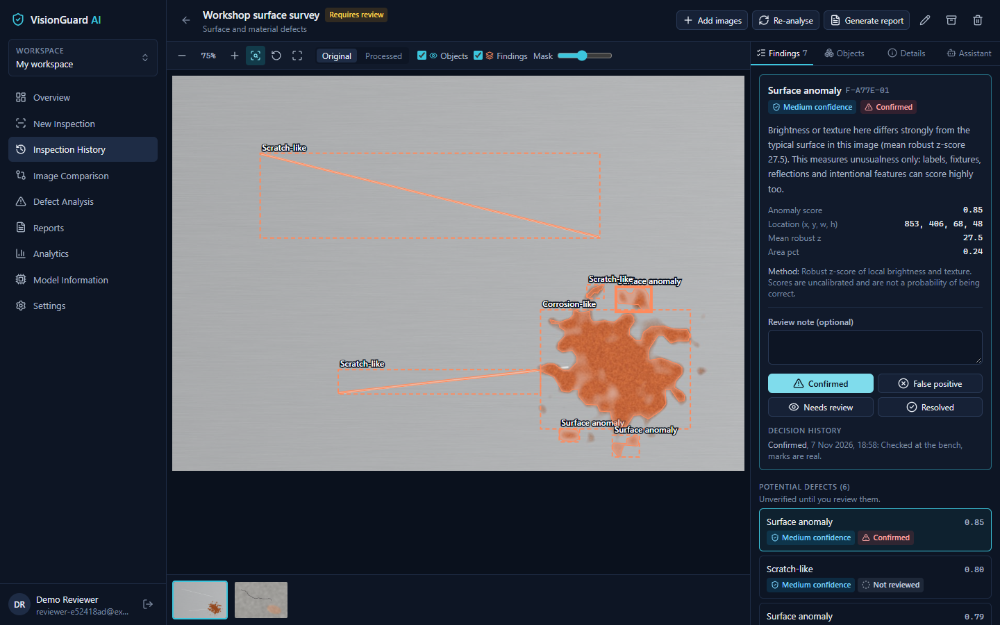

## Main features

Everything in this list is implemented and was exercised by the automated tests described in [TESTING.md](TESTING.md).

| Area | What it does |
|---|---|
| **Object detection** | YOLOX-Tiny (Apache-2.0) on CPU through ONNX Runtime. Boxes, labels and confidence for the 80 COCO categories |
| **Potential defect analysis** | OpenCV heuristics for crack-like and scratch-like marks, surface anomalies, discolouration and corrosion-like patterns, each with its method explained |
| **Segmentation** | Region outlines for findings, and approximate GrabCut outlines for detected objects, with adjustable opacity |
| **Honest uncertainty** | High, medium, low and unverified bands. Heuristic scores can never reach "high". Each category states what it cannot assess, such as dents |
| **Inspection workspace** | Zoom, fit, reset, full screen, overlay toggles, original and processed views, selectable findings |
| **Human review** | Confirmed, false positive, needs review or resolved, with notes and a full decision history |
| **Image comparison** | Side-by-side, overlay slider and difference heatmap, with ORB and RANSAC alignment, SSIM and visible warnings about lighting and alignment |
| **Inspection assistant** | Answers from stored records with no external service. Optionally uses Claude, restricted to those records |
| **PDF reports** | Previews, highlighted regions, confidence, review decisions, comparisons and limitations |
| **Analytics** | Dashboard, trends, and false-positive rates from your own reviews. No invented accuracy figures |
| **Accounts and security** | Argon2 password hashing, per-user data isolation, upload hardening and rate limiting |
| **Demo mode** | A separate, labelled workspace analysed by the real pipeline, removable in one click |

**Not implemented:** dent detection, missing-component detection, trained defect models, sharing between users, and a single sign-on option. See [Roadmap](#roadmap).

## Screenshots

These come from the running application, using generated surfaces and CC0 sample photos.

| | |
|---|---|
| 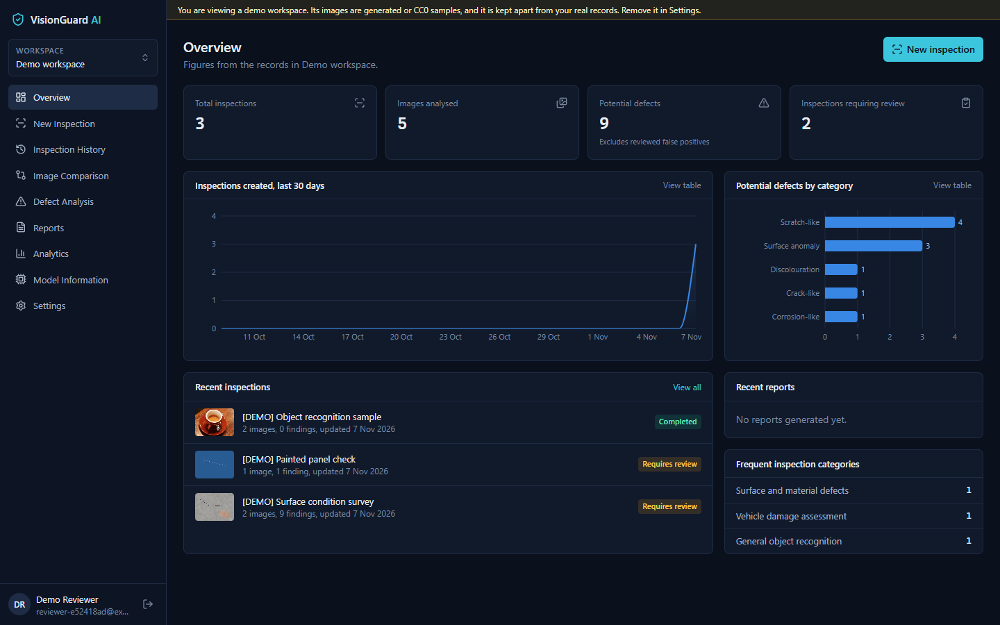 **Dashboard** | 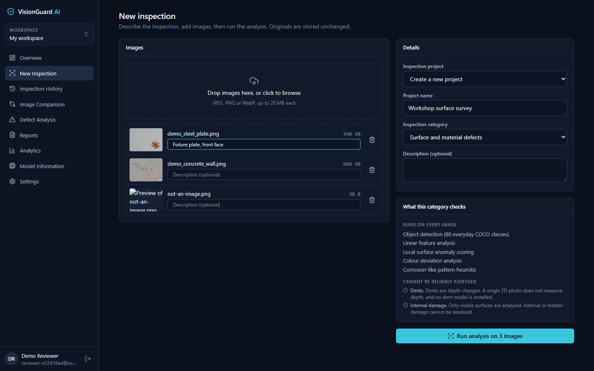 **New inspection and image upload** |
| 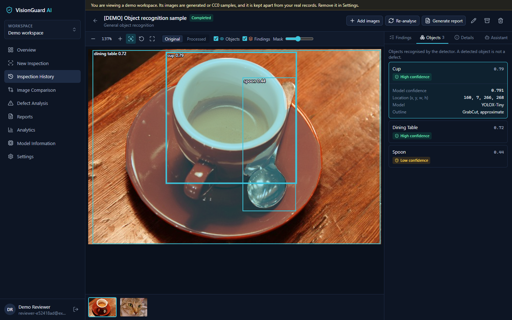 **Object detection** | 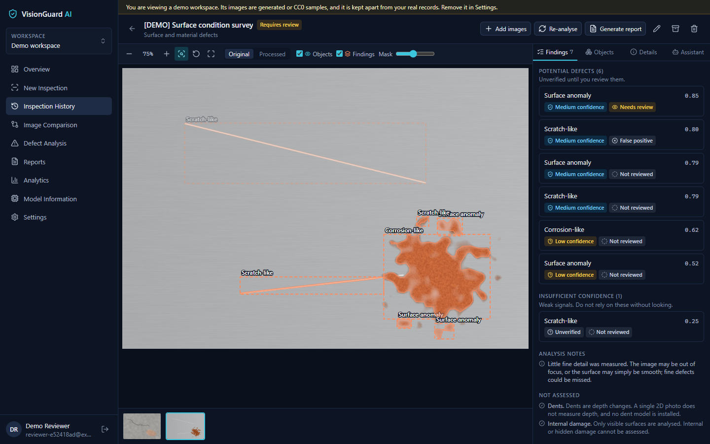 **Defect highlighting** |
| 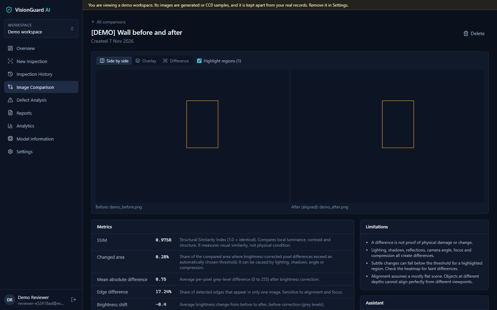 **Image comparison** | 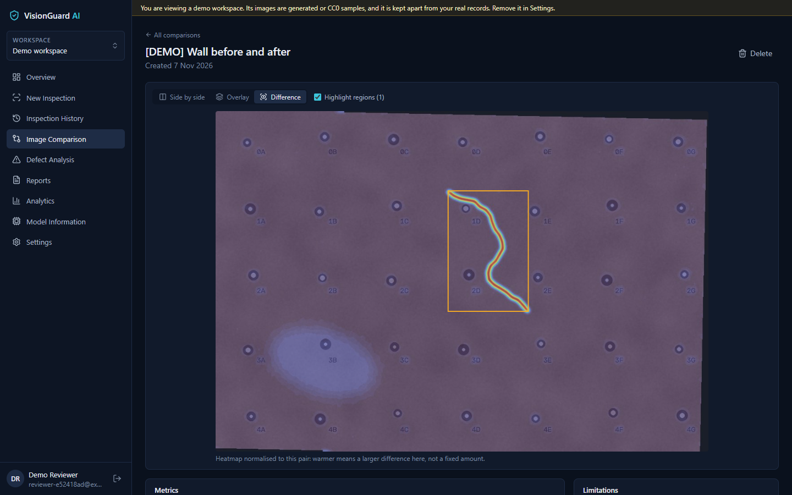 **Difference heatmap** |
| 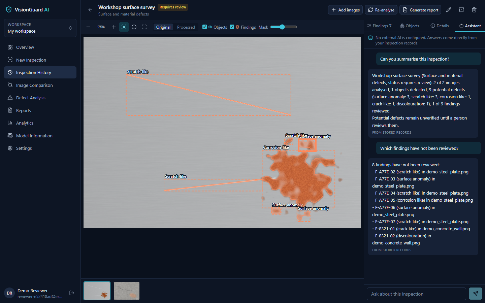 **Inspection assistant** | 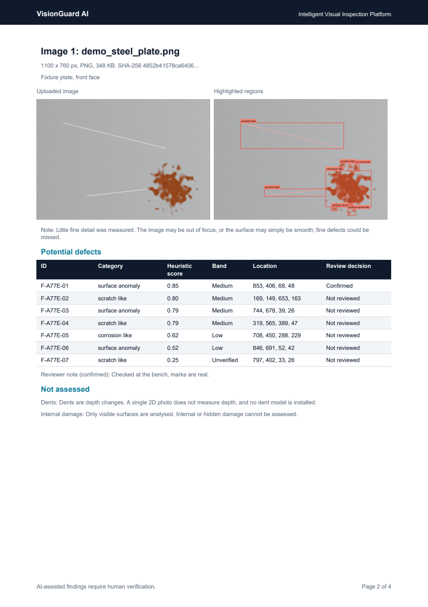 **A page of a generated PDF report** |
| 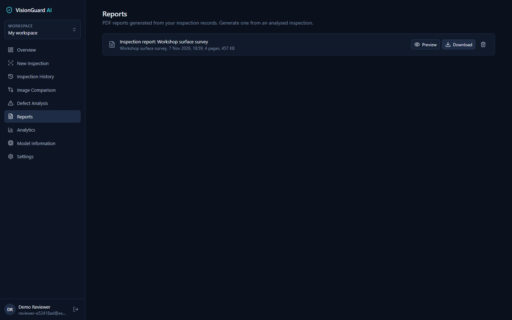 **Reports** | 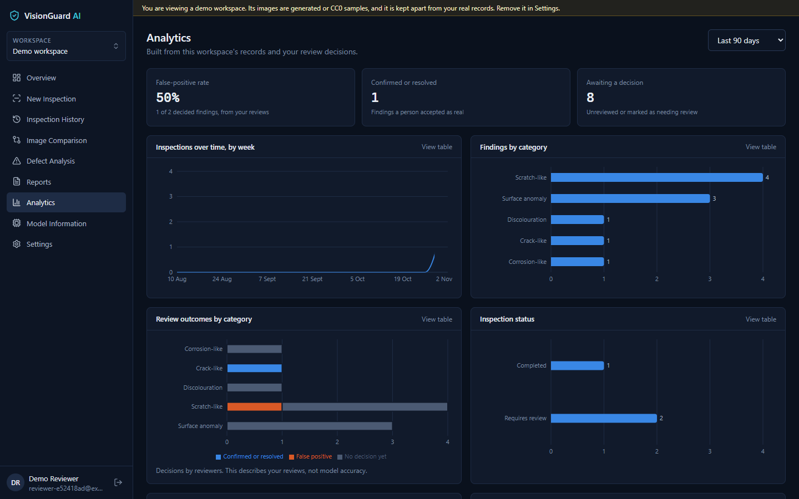 **Analytics** |

## Technology stack

- **Frontend:** React 19, TypeScript, Vite, Tailwind CSS, Recharts, Lucide icons
- **Backend:** Python 3.12, FastAPI, Pydantic, SQLAlchemy 2, Alembic
- **Computer vision:** OpenCV, ONNX Runtime, NumPy, Pillow, YOLOX-Tiny
- **Database:** PostgreSQL in production, SQLite for simple local use
- **Reports:** ReportLab
- **Optional AI:** the Anthropic Python SDK

**Why YOLOX and not Ultralytics YOLO?** Ultralytics is AGPL-3.0, which would impose licence obligations on this project. YOLOX is Apache-2.0, and ONNX Runtime avoids a multi-gigabyte PyTorch install, which suits CPU hosting.

## Architecture

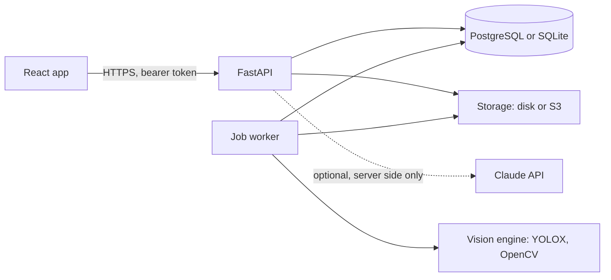

Long-running work goes through a database-backed queue, so API requests never block on inference. Read [ARCHITECTURE.md](ARCHITECTURE.md) for details.

## Quick start

You need [Python 3.11 or newer](https://www.python.org/downloads/) (3.12 is tested) and [Node.js 20 or newer](https://nodejs.org/). PostgreSQL is optional.

- **Windows:** double-click `Start App.bat`
- **macOS:** run `chmod +x "Start App.command"` once, then double-click `Start App.command`

The first start creates a virtual environment, installs packages, writes a `.env` with a random secret, downloads the 20 MB model and migrates the database. The app then opens at <http://127.0.0.1:5173>. Create an account, then choose **Explore demo data** or start an inspection.

[INSTRUCTION.md](INSTRUCTION.md) has manual setup, a usage guide and troubleshooting.

## Configuration

Settings live in `.env`, documented line by line in [.env.example](.env.example). For local use nothing is required. In production only `SECRET_KEY` is mandatory, and `CORS_ORIGINS` must name your frontend. Without AI credentials, every core feature still works.

## Demo mode

Choose **Explore demo data** on an empty dashboard, or use **Settings > Demo mode**. It creates a separate workspace with generated surfaces and two CC0 photos. All of them run through the real pipeline, and only the sample review decisions are scripted. Demo records carry a `[DEMO]` prefix and a banner, never count towards real statistics, and can be removed in Settings.

## API documentation

With the backend running in development, interactive docs are at <http://127.0.0.1:8010/docs>. [API_DOCUMENTATION.md](API_DOCUMENTATION.md) is the written reference. `/docs` is disabled by default in production.

## Testing

```bash
cd backend && python -m pytest
cd frontend && npm test
```

Verified results and known gaps are in [TESTING.md](TESTING.md).

## Security and privacy

- Passwords are hashed with Argon2, and every resource is checked for ownership on the server.
- Uploads are validated by content and decoded before storage, with limits on size and pixel count.
- Files get random server-side names and are only served to their authenticated owner.
- Original uploads stay unchanged. The copies used for display, analysis and reports have EXIF removed, so GPS data never reaches a report. The original file, which you can download yourself, keeps its EXIF.
- API keys stay on the server. Without external AI configured, nothing leaves your server.

See [SECURITY.md](SECURITY.md).

## Limitations

- The object detector knows only 80 everyday categories, not industrial parts or defects.
- The defect heuristics measure visual unusualness. Seams, labels, shadows and wood grain can all trigger them, and real defects can be missed.
- They assume a mostly uniform surface, so they are skipped, with a note, on visually complex scenes.
- The thresholds were tuned on generated samples. **No accuracy figures exist**, because no labelled ground-truth dataset has been evaluated. Measure performance on your own images before relying on it.
- A comparison difference is not proof of physical change.
- Rate limits are per process, and the bundled worker fits a single instance.

## Roadmap

- Evaluate on a labelled dataset and publish the measured precision and recall
- Support custom-trained defect models through the existing detector interface
- Reference-based checks for missing components
- Team workspaces and sharing
- Distributed rate limiting for multi-instance deployments

## Deployment

[RENDER_DEPLOYMENT.md](RENDER_DEPLOYMENT.md) covers Render, in two ways: the `render.yaml` Blueprint (separate API, frontend and database), or the root `Dockerfile`, which runs the API and web app together as one service. An untested `docker-compose.yml` is also included.

## Contributing

Please read [CONTRIBUTING.md](CONTRIBUTING.md). To report a vulnerability, follow [SECURITY.md](SECURITY.md).

## Licence

Project code is under the [MIT Licence](LICENSE). Third-party components and the model keep their own licences, listed in [THIRD_PARTY_NOTICES.md](THIRD_PARTY_NOTICES.md).
